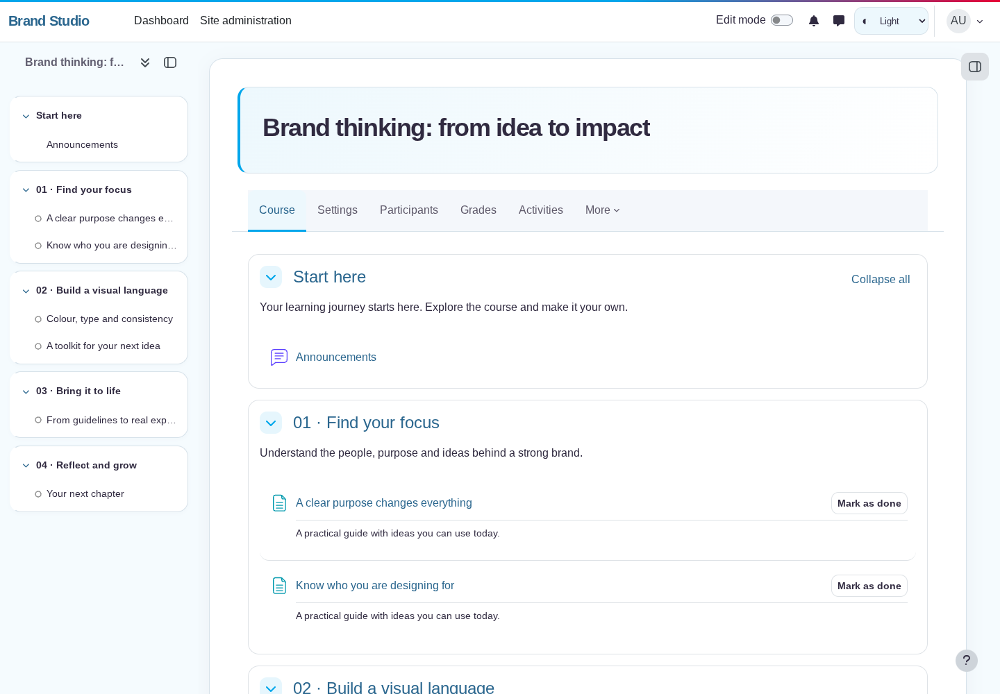
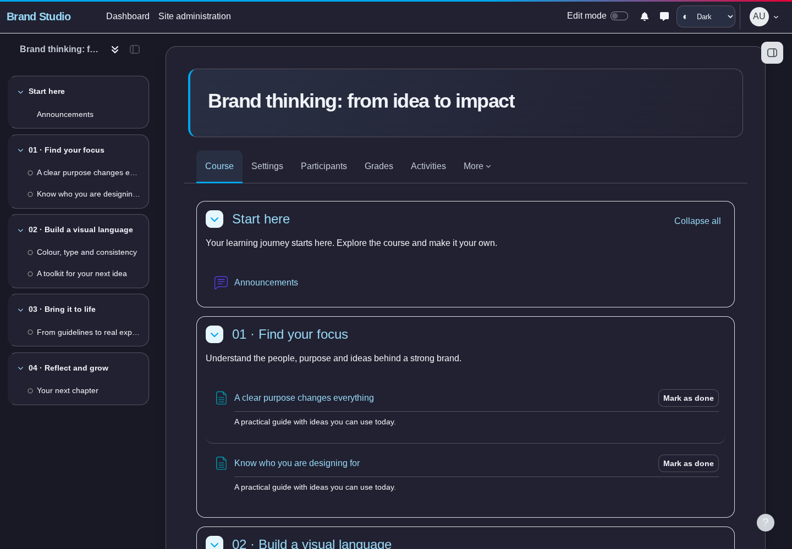

# Moodle Themes

Брендированные темы Moodle. Исходники, установочные ZIP и проверки организованы отдельно
для каждой темы и каждой поддерживаемой версии Moodle.

## Скачать Brand Boost для Moodle 5.2

[](packages/brandboost/moodle-5.2/theme_brandboost_moodle52_2026102000.zip?raw=true)

**Brand Boost 1.0.0 · beta · Moodle 5.2.** Кнопка скачивает готовый плагин с папкой `brandboost/`
в корне ZIP. Загрузите этот файл в Moodle **без распаковки**:
**Администрирование → Плагины → Установка плагинов**.
Node.js и сборка на сервере Moodle не нужны.

| Тема | Moodle | Выпуск | Установка | Документация |
| --- | --- | --- | --- | --- |
| Brand Boost | **5.2** | 1.0.0 beta · `2026102000` | [Скачать ZIP](packages/brandboost/moodle-5.2/theme_brandboost_moodle52_2026102000.zip?raw=true) | [Настройки и установка](themes/brandboost/moodle-5.2/brandboost/README.md) |

Другие версии Moodle, включая 4.0, пока не выпущены. Каждая будущая версия будет иметь
собственные исходники, проверки и установочный ZIP; совместимость не определяется только названием темы.

## Что входит в Brand Boost

- Дочерняя тема **Boost**, сохраняющая его навигацию, формы, редактирование и поведение курсов.
- Восемь редактируемых брендовых цветов; основные — **#00A6EB** и **#E60036**.
- Светлый, тёмный и системный режимы. Администратор задаёт режим сайта и разрешает переключение.
- Разделы бокового меню в виде карточек. Штатные кнопки **закрытия и открытия** работают,
  состояние панели сохраняется Moodle.
- Новое оформление страницы входа, карточек, вкладок, кнопок и форм, адаптация к мобильным экранам.
- Штатные **логотип, компактный логотип и favicon** из настроек Moodle.
- Пресеты Boost, загрузка своих SCSS-пресетов, фоны и дополнительные SCSS-настройки.
- Русский и английский интерфейс настроек темы.

| Светлый режим | Тёмный режим |
| --- | --- |
|  |  |

[Страница входа](docs/screenshots/brandboost/moodle-5.2/login-light.png) ·
[Мобильная версия](docs/screenshots/brandboost/moodle-5.2/course-mobile.png)

Скриншоты сняты с работающего Moodle 5.2 на демонстрационном курсе.
Тёмное оформление сторонних плагинов и содержимого внутри iframe проверяется отдельно.

## Установка и настройки

1. Скачайте ZIP для своей версии Moodle и установите через страницу плагинов.
2. Завершите обновление на странице **Администрирование → Уведомления**.
3. В **Внешний вид → Темы → Выбор темы** выберите **Brand Boost**.
4. Палитра и режимы: **Внешний вид → Темы → Brand Boost**.
5. Логотипы и favicon: **Внешний вид → Логотипы**.

Boost должен оставаться установленным. Тема не меняет его исходники.
Настройки Brand Boost отдельные: собственные фоны, пресеты и SCSS из Boost при переходе
переносятся в настройки новой темы; глобальные логотипы используются сразу.

[Подробная инструкция](themes/brandboost/moodle-5.2/brandboost/README.md) ·
[Результаты проверки](docs/validation/brandboost-moodle-5.2.md) ·
[Контрольные суммы ZIP](packages/SHA256SUMS)

## Структура репозитория

```text
catalog.json                              Каталог выпускаемых вариантов
themes/<тема>/moodle-<версия>/<плагин>/     Исходники конкретного варианта
packages/<тема>/moodle-<версия>/*.zip       Готовые установочные плагины
packages/SHA256SUMS                       Контрольные суммы
tests/<тема>/moodle-<версия>/              Тесты конкретного варианта
docs/screenshots/<тема>/moodle-<версия>/    Скриншоты
docs/validation/                         Результаты проверок
tools/                                   Общие команды сборки и упаковки
```

Так новые темы и варианты для других версий Moodle можно добавлять независимо.
В `catalog.json` указаны компонент темы, целевая версия Moodle, версия плагина,
путь к исходникам и путь к ZIP. Один ZIP содержит один плагин для указанной версии Moodle.

## Разработка и выпуск

Требуются Node.js 24 и Python 3. Команды выполняются из корня этого репозитория:

```sh
npm ci
npm run build
npm test
npm run package
```

Сборка обрабатывает варианты из `catalog.json`, компилирует AMD-модули и создаёт
ZIP с постоянными метаданными и контрольными суммами. ZIP хранятся в Git, поэтому
кнопки скачивания работают в ветке MR и после слияния в `main`.
CI проверяет сборку, JavaScript-тесты, PHP-синтаксис и соответствие ZIP исходникам.
Проверки в настоящем Moodle запускаются отдельно по [инструкции](docs/DEVELOPMENT.md).

Чтобы добавить вариант для другой версии Moodle или новую тему, следуйте
[правилам структуры и выпуска](docs/DEVELOPMENT.md). Адаптация к Moodle 4.0 потребует
отдельного адаптера под Bootstrap 4 и проверки навигации этой версии.

Лицензия: GNU GPL v3 или новее. Текст лицензии включён в каждый плагин.
